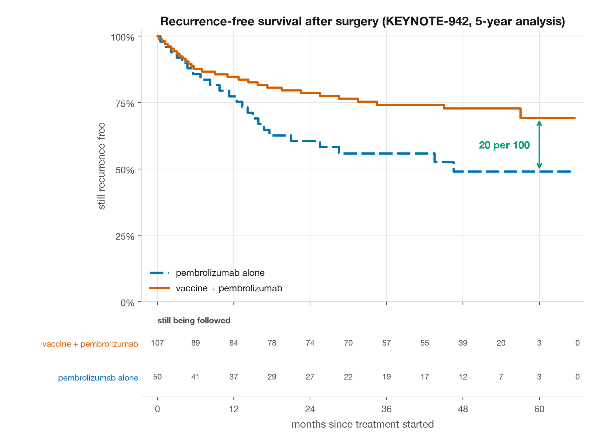
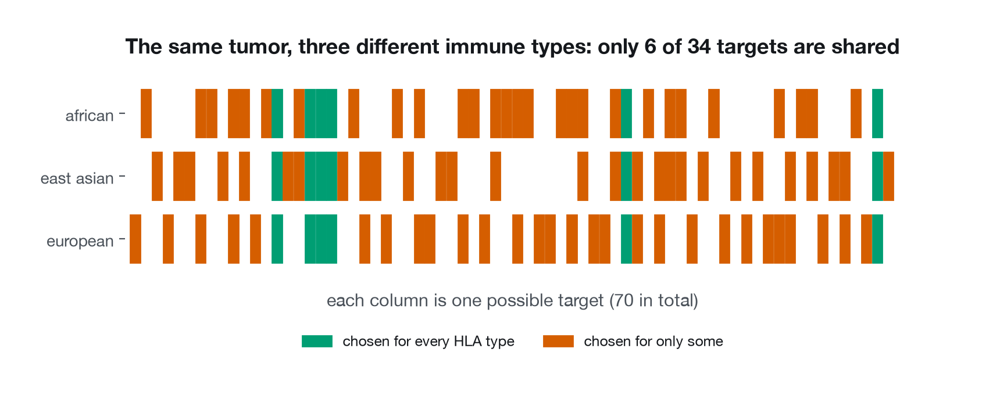

# Your Tumor, Your Vaccine

**How a personalized cancer vaccine is designed, and what the evidence for one actually shows.**

An open, reproducible explainer of mRNA-4157 / V940 (intismeran autogene) — the individualized
neoantigen therapy Moderna and Merck are developing with pembrolizumab (KEYTRUDA).

> **Educational project. Not medical advice. Not affiliated with Moderna or Merck.**
> This product is investigational and is **not approved by any regulator anywhere**.
> See [DISCLAIMER.md](DISCLAIMER.md).



**[Read the interactive explainer &rarr;](https://isarinio22.github.io/moderna/)**

---

## Explain it simply

Every tumour rewrites its own DNA as it grows. Those typos are not in any of your healthy cells,
which makes them the one thing that is unambiguously *tumour* and not *you*.

1. **Read the typos.** Sequence the tumour and a normal sample, and list the mutations that change
   a protein.
2. **Work out which ones are visible.** Your cells constantly shred proteins into short fragments
   and display them on the surface, held by molecules called HLA. Only some fragments get
   displayed — which ones depends on your personal HLA type. A mutation nobody can see is useless
   as a target.
3. **Pick the best ~34.** Rank the visible, mutated fragments and choose a few dozen.
4. **Print the wanted posters.** Encode those fragments in one mRNA strand. Your own cells read it
   and display the fragments, and your immune system learns the faces.
5. **Take the brakes off.** Tumours press an "ignore me" button on T cells. Pembrolizumab blocks
   that button, so the T cells that just learned the faces are able to act.

This repository simulates step 1–4 on public tumour data, and then examines — carefully — whether
step 5 plus the vaccine actually helped the patients in the trial.

## What the evidence shows, honestly

In the Phase 2b trial (KEYNOTE-942, **157 patients**, randomized 2:1, **open-label**), patients
who got the vaccine plus pembrolizumab after surgery recurred less often than those who got
pembrolizumab alone. At five years, **68.8% vs 49.1%** were still recurrence-free —
a hazard ratio of **0.51 (95% CI 0.294–0.887)**.

That is a genuinely encouraging result. It is **not proof**, for reasons this project spells out
rather than glosses over:

- The trial was powered at a **one-sided alpha of 0.10** — a looser bar than the conventional
  two-sided 0.05. The headline p-value of 0.0266 at the primary analysis is one-sided; two-sided
  it is **0.053**. It met its own prespecified bar and would not have met the conventional one.
- It was **open-label**. Everyone knew who got what, and "has this patient recurred?" depends on
  when a scan gets ordered and how a lesion is called.
- 157 patients and 51 recurrence events is small. The confidence interval is compatible with a
  very large benefit *and* with a modest one.
- Only the first analysis was statistically protected. The 3-year and 5-year p-values are
  **nominal** — repeated looks at the same patients with no multiplicity control.
- **Survival data is uninformative**: 7 deaths in each arm, 14 in the whole trial.
- Phase 3 (INTerpath-001) announced in August 2026 that it met its endpoints, but **no hazard
  ratio or p-value is public yet**. That trial, not this one, is the real test.

Every number above is sourced in [research/sources.md](research/sources.md) with its link,
publication date and data-cutoff date.

## Technical deep dive

### Part 3 — the explainer

A single scrollytelling page, built with vanilla JavaScript and inline SVG. No
framework, no build step, nothing to rot. It reads the same JSON the pipeline
exports, so the numbers on the page are the numbers the code produced, and every
file is downloadable.

Colours come from the Okabe-Ito palette, which stays distinguishable under every
common form of colour vision deficiency — but vermillion and blue sit close in
lightness, so the two trial arms also differ in line style and would still read
on a monochrome printout. Every figure has a static PNG twin in
[figures/](figures/), built by matplotlib from the same data.

### Part 4 — the LinkedIn assets

A nine-slide carousel at 1080×1350 (`make carousel`), a seventeen-second
animation of the pipeline (`make video`), and a post draft. All three are built
from the same exported JSON, so they cannot drift from the analysis.

A test lints every word this project ships — README, disclaimer, site, slides,
sources and post — against a list of phrases that would overstate the evidence.
Another asserts the post stays under LinkedIn's limit and that the one-sided
p-value never appears without its conventional two-sided counterpart.

The video is deliberately excluded from `make all` and from git: ffmpeg embeds
encoder metadata that cannot be fully suppressed, so it is not byte-reproducible
and would make the working tree permanently dirty.

### Part 1 — how a personalized vaccine is designed

Six stages, each independently runnable, from a public tumour sample to a
labelled conceptual mRNA construct.

| Stage | What it does |
|---|---|
| 1. fetch | Somatic mutations and gene expression for one de-identified TCGA melanoma sample, via the free cBioPortal API |
| 2. annotate | Resolve each mutation to a protein position, fetch the real protein sequence, **and verify it** |
| 3. peptides | Every 8–11-residue fragment spanning each mutation, paired with its normal counterpart |
| 4. predict | MHC class I presentation for a panel of common HLA types, with MHCflurry |
| 5. rank | Score on presentation, mutant-vs-normal advantage, expression and peptide quality; select up to 34 |
| 6. construct | Assemble a labelled, conceptual mRNA: epitopes, linkers, codon-optimised coding sequence, UTR and poly-A blocks |

**The part that actually matters is stage 2.** A mutation call says "valine 600
became glutamate". To build peptides you need the protein sequence around
position 600 — and if the sequence you fetch uses different numbering, position
600 is a different residue, every peptide spanning it is wrong, and *nothing
raises an error*. The output looks completely normal.

This is not hypothetical. Ask the current Ensembl REST service for BRAF and you
get an 806-residue protein with threonine at position 600; TCGA mutation calls
use the 766-residue numbering where position 600 is valine. So this pipeline
verifies the reference amino acid against the sequence before building any
peptide, treats a disagreement as a rejection rather than a warning, aborts the
run if disagreements exceed a quarter of the sample, and blocks the wrong
service at the network layer so the mistake cannot be made by accident.

Three other decisions worth calling out:

- **Mutant and normal peptides are always compared on the same HLA type.**
  Otherwise you measure the change of HLA type rather than the effect of the
  mutation.
- **At most one peptide per mutation and two per gene.** A single strongly
  presented mutation yields dozens of overlapping fragments that all score well;
  without caps the construct fills with 34 views of one target, and the vaccine
  fails entirely if the tumour loses that one mutation.
- **Everything discarded is kept and published,** with a machine-readable reason.
  A pipeline that silently drops 40% of its input while appearing to work is the
  most dangerous failure mode in this field.

What this does *not* do: no matched normal sample, no variant phasing or
clonality, no immunogenicity model, no self-proteome subtraction, no
manufacturing constraints. Those are the difference between a teaching
simulation and the real thing.

On the real TCGA sample, 128 mutations narrow to 120 that can be placed on a
verified protein, 4,509 candidate fragments, and 34 chosen targets — in 26
seconds. Two results worth noting. The pipeline finds **NRAS Q61K**, one of the
best-known melanoma driver mutations, but its mutated fragment binds HLA-A\*01:01
essentially as well as the normal protein does (26 nM against 25), so a famous
mutation turns out to be a mediocre target. And the HLA-A\*02:01 peptides it
selects show the textbook anchor motif — leucine or valine at position 2, and a
small hydrophobic residue at the end — which nothing in the code puts there.



**Why it has to be personal.** Running the identical tumour against three sets of
common HLA types, only **6 of 34** targets are shared by all three. About 80% of
the vaccine changes with the patient's immune genetics.

### Part 2 — what the evidence actually shows

Patient-level recurrence-free survival for KEYNOTE-942, rebuilt from the trial's
published summary table, refitted, and compared against what was published.

The original plan was to digitise the Kaplan-Meier curves out of conference
slides. That turned out to be unnecessary: the five-year figure publishes
*cumulative censored* counts alongside patients-at-risk, and those two columns
force the number of recurrences in every interval by arithmetic.

```
recurrences = at_risk[i] - at_risk[i+1] - censored_during_interval
```

No iteration, no curve fitting, no reading pixels off a picture. The derived
counts sum to exactly the separately published totals of 28 and 23 — a
constraint that was not chosen and cannot be tuned.

| | reconstructed | published |
|---|---:|---:|
| hazard ratio | 0.506 | 0.510 |
| 95% interval | 0.291–0.880 | 0.294–0.887 |
| recurrences | 28 / 23 | 28 / 23 |
| 5-year, vaccine arm | 69.2% | 68.8% |
| 5-year, control arm | 49.1% | 49.1% |

All ten landmark estimates land within half a percentage point. The only
assumption left is where a recurrence falls inside a six-month window, and the
hazard ratio moves by **0.0065** across every reasonable choice — so the
conclusion does not rest on the assumption. `make evidence` prints the full
discrepancy table, including the one quantity that drifts (the control arm's
median, 46.5 months against 44.65).

Two things the code refuses to do, enforced by tests rather than judgement:
overall survival is never reconstructed, because 14 deaths in the whole trial
would draw as two curves that look like a finding; and the three-year analysis is
quoted only, because interpolating a curve between two real reconstructions would
be fabrication.

## How to run

```bash
make setup       # Python 3.11 virtualenv, dependencies, prediction models
make all         # everything: pipeline, site data, figures (~30 s once cached)
make synthetic   # the same, fully offline, no model download
make test        # 233 tests, offline, no model download
make evidence    # reconstruct the trial and print the validation table
make site        # serve the explainer at http://127.0.0.1:8000
make summary     # what the last run selected
make carousel    # the LinkedIn slide deck
make video       # the pipeline animation (needs ffmpeg)
```

The whole test suite and a full pipeline rebuild run **without PyTorch or the
prediction models installed**, on a deterministic stub predictor — which is what
keeps CI to a couple of minutes. The real models are exercised by a scheduled
workflow that also checks the four public APIs for upstream drift.

The responses needed for the default sample are committed, so `make all` works
on a fresh clone with no network access once the models are present. Individual
stages run on their own (`python -m neoag peptides`), and the build is
incremental: changing a scoring weight re-ranks without re-running prediction.

## Sources and limitations

- [research/sources.md](research/sources.md) — every number, with link, publication date and
  data-cutoff date. Anything that could not be verified from a primary source is flagged there
  and is not used.
- [DISCLAIMER.md](DISCLAIMER.md) — what this project is and is not.

Two limitations are worth stating up front, because they shape everything downstream:

**The public tumour data has no HLA typing.** Which fragments a person can display depends
entirely on their HLA type, and cBioPortal publishes none for TCGA samples. This project runs a
panel of common HLA types and shows how the selection shifts across them. That is a stated
assumption, not a result.

**The patient-level trial data is reconstructed, not real.** It is derived from published
Kaplan–Meier curves and at-risk tables, and it reproduces the published summary statistics — but
no individual in it corresponds to a real person, and it cannot support any claim about subgroups
or covariates.

## Acknowledgements

The results here are in whole or part based upon data generated by the
[TCGA Research Network](https://www.cancer.gov/tcga). Tumour data accessed via
[cBioPortal](https://www.cbioportal.org) (Cerami et al. 2012; Gao et al. 2013; de Bruijn et al.
2023). Epitope prediction by [MHCflurry](https://github.com/openvax/mhcflurry)
(O'Donnell et al. 2020). Survival analysis with
[lifelines](https://github.com/CamDavidsonPilon/lifelines). Patient-data reconstruction follows
Guyot et al., *BMC Med Res Methodol* 2012;12:9.

KEYTRUDA is a registered trademark of Merck Sharp & Dohme LLC. All trademarks belong to their
owners.

## License

[MIT](LICENSE).
